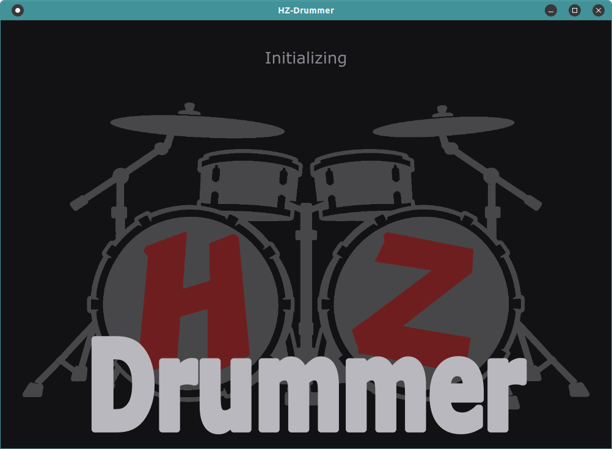
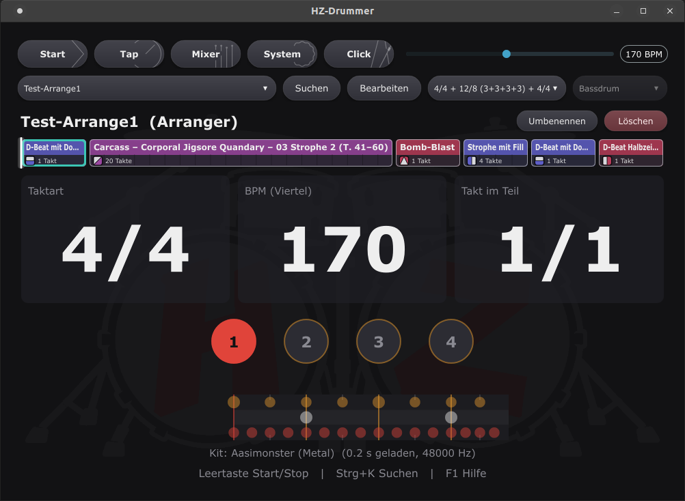
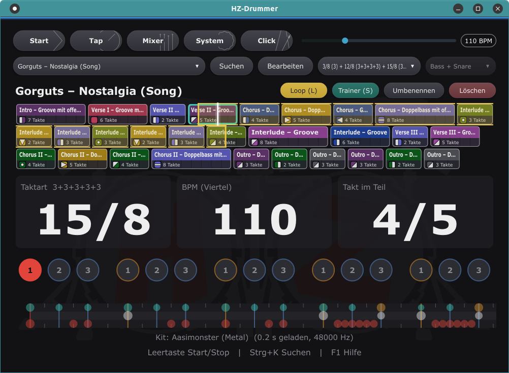
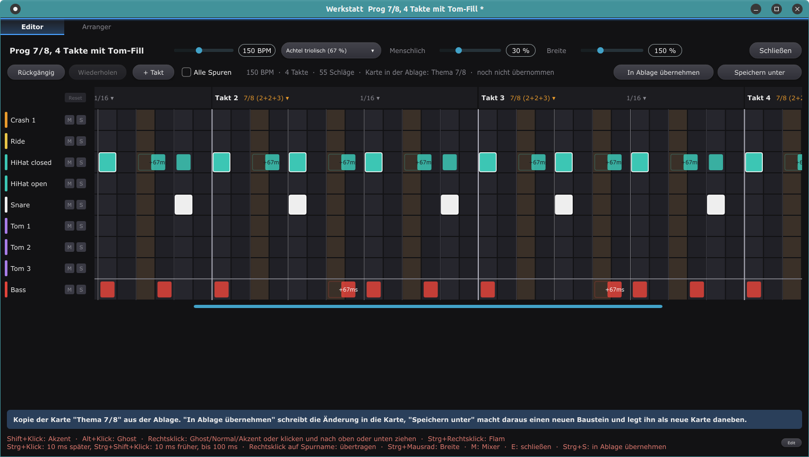
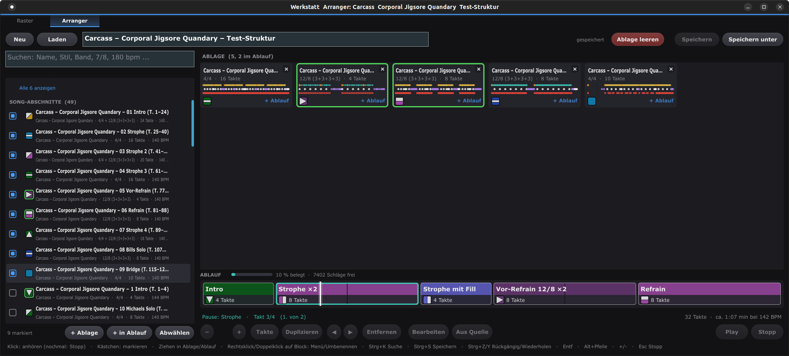
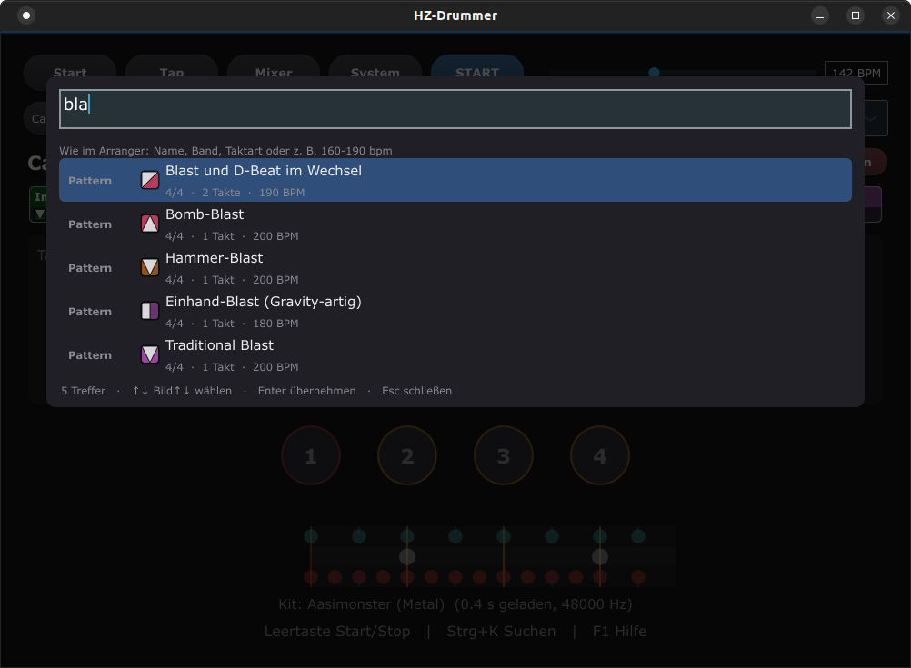
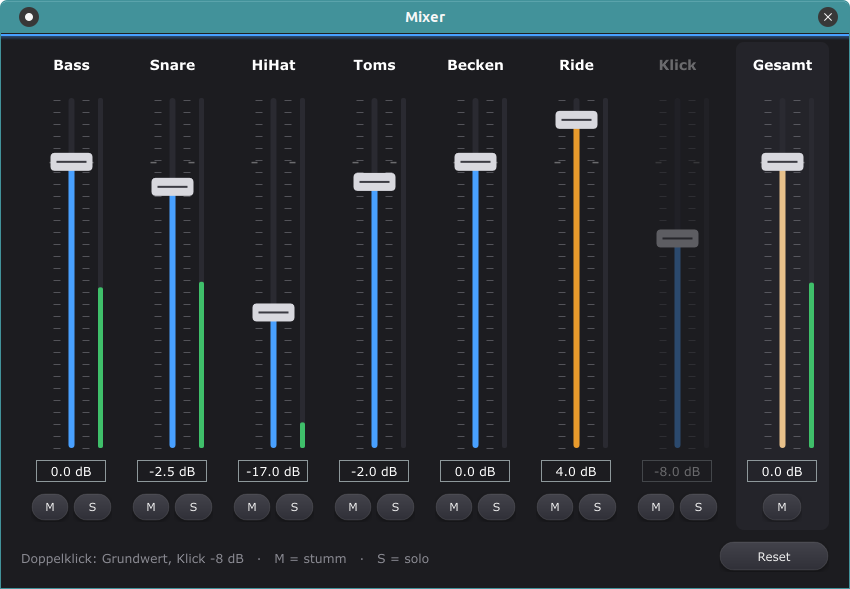

# HZ-Drummer

Drum-Machine zum Üben und Mitspielen, für Gitarre, Bass und Schlagzeug oder Blockflöte, mit Fokus auf Metal: realistische Samples, Patterns in allen Taktarten bis hin zu Polyrhythmen, eine Bibliothek von D-Beat bis Tech-Death, ein Raster-Editor für eigene Grooves und ein Arranger, der aus Bausteinen ganze Songabläufe macht. C++ mit JUCE, entwickelt und getestet unter Ubuntu 22.04.

**Auf einen Blick**

- **Drummer und Drum-Machine** zur einfachen Erstellung von kleinen Bausteinen bis zu komplexen Arrangements (Songs)
- **Große Bibliothek**, aktuell mit Fokus auf Metal
- **Quellenimport**: weitere Bausteine per Klick von ihren Originalquellen
- **Jeder Baustein individuell anpassbar**
- **Einzählen, Loops und Speed-Trainer** zum Üben

Gedacht ist es zum Üben, nicht für Studioaufnahmen: Es soll ohne Umwege den richtigen Groove im richtigen Tempo liefern, damit man gleich zum Instrument greifen kann.



<p>


</p>
<p>


</p>
<p>


</p>

## Was es kann

- **Patterns** in beliebigen Taktarten, auch gemischt innerhalb eines Patterns, mit Akzenten, Ghost-Notes, Flams, offener HiHat, Swing, verzögerten oder vorgezogenen Schlägen (Versatz bis ±100 ms, „laid back“ oder treibend) und einstellbarer „Menschlichkeit“.
- **Bibliothek** mit Grooves nach Stil (D-Beat, Thrash, Death, Grind, Doom, Hardcore, Prog, Tech-Death, Jazz) und Vier-Takt-Phrasen mit Übergängen.
- **Raster-Editor** („Werkstatt“): Schläge setzen, Lautstärke ziehen, Takte und Taktarten je Takt ändern, Mute und Solo je Spur, Besen-Spuren, „Übertragen auf“ (eine ganze Spur auf eine andere, etwa Hi-Hat auf Ride), Rückgängig und Wiederholen, sofort hörbar.
- **Arranger**: Songabläufe aus Bausteinen, mit Ablage, Taktbereichen, lokalen Varianten, Sprung auf jeden Block und Spulen am Positionsstrich, auch mitten in lange Bausteine.
- **Abzeichen** aus Farbe und Form an jedem Baustein, damit man ihn in Menü, Ablage und Ablauf sofort wiedererkennt.
- **Schnellnavigation per Pfeiltasten** durch Ordner und Favoriten, ein kurz eingeblendetes Menü zeigt, wo man ist; **Verlauf** mit Alt+←/→ wie im Browser, um einen guten Fund wiederzufinden.
- **Loop und Speed-Trainer**: einen Bereich ganzer Takte per Shift+Ziehen loopen, das Tempo nach jeder Runde stufenweise steigern; zehn benannte **Speicherplätze** für Übestellen mit Bereich und Trainer-Werten.
- **Suche** über alles mit Filtern wie `7/8` oder `160-190 bpm`, Vorhören direkt im Menü.
- **Einzählen** vor dem Start, Tap-Tempo, Mixer je Instrument mit Pegelanzeige, Metronom mit eigenen Taktarten.
- **Ordnerstruktur** und **Papierkorb** für eigene Patterns und Songs.
- **Startpaket**: Groove MIDI (echte Einspielungen), R.P. Bardet, kurze Loops von Carcass und Exhorder und drei Beispiel-Arrangements, beim ersten Start schon da, siehe [community/](community/).
- **Quellenimport** per Klick (System › Quellen): weitere Bausteine, die nicht mitgeliefert werden dürfen (MT Power, Band-Songs, Guitar-Pro-Tabs, MIDI), lädt das Programm von der Originalquelle und wandelt sie auf dem eigenen Rechner um, mit Import-Log.
- **Import-Vorlagen** für Guitar Pro, MIDI, Hydrogen und gedruckte Pattern-Bücher unter [tools/import](tools/import/README.md), auch als Vorlage für KI-Assistenten.

## Voraussetzungen

| Was | Wofür |
|---|---|
| Linux, x86_64 | getestet unter Ubuntu 22.04 |
| C++-Compiler mit C++20, z. B. GCC 11 (Paket `build-essential`) oder Clang | Programm und Tests bauen |
| CMake ab 3.22, optional Ninja | Build-System (JUCE verlangt 3.22) |
| Git | Klonen, JUCE kommt als Submodul mit |
| ALSA, JACK, FreeType, Fontconfig, X11 (Pakete im Schnellstart) | Audio und Oberfläche |
| rund 140 MB für `build/`, rund 400 MB für das Drum-Kit | Platz |
| Python 3 (bei Ubuntu dabei) | System › Quellen und die Import-Werkzeuge unter `tools/` |
| optional Java und TuxGuitar 1.5.6 | Guitar-Pro-Dateien umwandeln, siehe [docs/SETUP.md](docs/SETUP.md) |
| optional Internet | System › Quellen lädt von den Originalquellen |

## Schnellstart

Die Schritte sind so geschrieben, dass sie ein Mensch oder ein KI-Assistent direkt ausführen kann. Getestet unter Ubuntu 22.04.

```bash
sudo apt install -y build-essential cmake git pkg-config ninja-build libasound2-dev libjack-jackd2-dev libfreetype-dev libfontconfig1-dev libx11-dev libxcursor-dev libxext-dev libxinerama-dev libxrandr-dev libxrender-dev libxi-dev
git clone --recurse-submodules --shallow-submodules https://github.com/dooomkopf/HZ-Drummer.git
cd HZ-Drummer
cmake -S . -B build -G Ninja -DCMAKE_BUILD_TYPE=Release
cmake --build build                           # einige Minuten, build/ belegt rund 140 MB
(cd build && ctest --output-on-failure)       # Engine- und App-Tests
./tools/install-desktop.sh                    # Starter im Anwendungsmenü (optional)
./tools/run.sh                                # oder direkt starten
```

- **Pakete:** Das sind alle, die der Build braucht, geprüft an den System-Headern, die der Compiler tatsächlich liest. `ninja-build` ist nur für `-G Ninja` nötig, ohne den Schalter baut CMake mit make. OpenGL-, Mesa- und XComposite-Pakete braucht HZ-Drummer nicht.
- **Klonen:** `--shallow-submodules` holt von JUCE nur den aktuellen Stand statt der ganzen Historie. Das Repo selbst bitte **nicht** mit `--depth 1` klonen: Die Versionsnummer (v0.2.‹Anzahl Commits›) zählt die Commits.
- **Audio:** Gebaut wird mit JACK-Unterstützung, zum Abspielen reicht ALSA. Wer JACK über PipeWire nutzen will, installiert `pipewire-audio-client-libraries` und schaltet es unter 22.04 einmalig frei: `sudo cp /usr/share/doc/pipewire/examples/ld.so.conf.d/pipewire-jack-*.conf /etc/ld.so.conf.d/ && sudo ldconfig`.

Ohne Kit startet das Programm, spielt dann aber nur den Klick. Deshalb einmalig:

## Drum-Kit einrichten

Die Samples sind nicht Teil dieses Repos. Das Programm nutzt das **Aasimonster**-Kit von [DrumGizmo](https://drumgizmo.org) (CC-BY 4.0), ein mehrfach mikrofoniertes Metal-Kit, auf Stereo-Samples heruntergemischt. Zwei Wege:

**A) Fertiges Kit kopieren**, etwa von einem Rechner, auf dem es schon eingerichtet ist: den Ordner `kits/aasimonster/` (etwa 400 MB, eine `kit.json` und je ein Unterordner mit WAV-Dateien pro Instrument) in den Ordner `kits/` dieses Klons kopieren. Fertig.

**B) Selbst erzeugen** mit dem Werkzeug `kitprep` (einmalig, 2,4 GB Download, [Kit-Seite](https://drumgizmo.org/wiki/doku.php?id=kits:the_aasimonster)):

```bash
mkdir -p kits-src && cd kits-src
wget https://drumgizmo.org/kits/Aasimonster/aasimonster2_1.zip
unzip aasimonster2_1.zip                      # ergibt aasimonster2/ mit aasimonster.xml
cd aasimonster2
../../build/kitprep_artefacts/Release/kitprep aasimonster.xml ../../kits/aasimonster "Aasimonster (Metal)"
```

Danach liegt das fertige Kit unter `kits/aasimonster/`, das Programm findet es beim Start. Ordner `kits/` und `kits-src/` bleiben außerhalb der Versionsverwaltung.

## Aufbau

| Ordner | Inhalt |
|---|---|
| `src/engine/` | Reines C++ ohne JUCE: Taktarten, Pattern-Modell, Tab-Parser, Pattern-Player (sample-genau, Humanisierung), Sample-Player, Bearbeitungsfunktionen |
| `src/app/` | JUCE-Oberfläche: Hauptfenster, Werkstatt mit Raster-Editor und Arranger, Suche, Mixer, Dateiformate |
| `library-src/` | Mitgelieferte Patterns als Drum-Tabs (Quelle, lesbar) |
| `library/` | Daraus übersetzte JSON-Bibliothek (wird vom Programm geladen) |
| `community/` | Pattern-Sätze von Mitwirkenden, siehe [CONTRIBUTING.md](CONTRIBUTING.md) |
| `tools/` | `patternc` (Tabs → JSON), `kitprep` (DrumGizmo-Kit → Stereo), `gpdrums` (Guitar-Pro-Schlagzeugspur → Patterns), `import` (Vorlagen für MIDI, Hydrogen und gedruckte Pattern-Bücher → Patterns, siehe [tools/import/README.md](tools/import/README.md)), Starter, Prüfskript für Community-Sätze |
| `tests/` | `engine_tests` (Timing, Taktarten, Parser, Player, Bearbeitung), `app_tests` (Dateiformate, Suche, Arranger-Modell) |
| `docs/` | Bedienung, Konzept, Formate, Entscheidungen |

## Dateien, Logik und Deinstallation

Das Programm legt außerhalb seines Ordners nur diese Dateien an:

| Ort | Inhalt |
|---|---|
| `~/.config/HZ-Drummer/` | Datenordner: `patterns/` (eigene Bausteine), `songs/` (Arrangements), `trash/` (Papierkorb), `ordner.json` (Ordnerstruktur), `abzeichen.json`, `ablage.json` und `arranger.json` (Arbeitsstand des Arrangers), `trainer.json` (Speicherplätze des Trainers) |
| `~/.config/HZ-Drummer/HZ-Drummer.settings` | persönliche Einstellungen: Audio-Gerät, Tempo, Fensterlage, Favoriten, Trainer, Tooltips |
| `~/.cache/HZ-Drummer/` | Protokolle `app.log` (auch Abstürze mit Aufrufstapel), `run.log` (Start), `import.log` (System › Quellen); `abzeichen/` (die letzten zehn Abzeichen-Verteilungen); `quellen/` (Downloads und Zwischenstände des Quellen-Imports) |
| `~/.local/share/applications/hz-drummer.desktop` | Starter, nur wenn `tools/install-desktop.sh` lief |

**Logik:**
- **Erster Start:** Gibt es weder `patterns/` noch `songs/`, kopiert das Programm das Startpaket in den Datenordner: die Community-Sätze (Carcass, Exhorder, Groove MIDI, R.P. Bardet) mit ihren Ordnern und Arrangements sowie drei Beispiel-Arrangements (Thrash, Prog, Doom) aus Bibliothek-Bausteinen. Danach nie wieder; vorhandene Dateien werden nie überschrieben. Siehe [community/README.md](community/README.md) und [docs/QUELLEN.md](docs/QUELLEN.md).
- **System › Quellen:** lädt Bausteine, die nicht mitgeliefert werden dürfen, von der Originalquelle, wandelt sie auf dem eigenen Rechner um und legt nur Neues in den Datenordner, die neuen Arrangements in einen Ordner je Band. Was schon da ist, ob selbst gemacht oder von einer älteren Installation, bleibt unverändert an seinem Platz. Was wegfällt oder vereinfacht wird, steht in `import.log` (System › Log-Dateien).
- **Abgleich:** Ist der Datenordner ein Git-Repo mit Remote `origin`, gleicht `tools/run.sh` ihn vor dem Start und nach dem Ende ab (`tools/sync-daten.sh`). Ohne Git passiert nichts.
- Die Bibliothek (`library/`) gehört zum Programm und wird nie in den Datenordner kopiert.

**Deinstallieren** (vorher den Datenordner sichern, wenn eigene Bausteine darin stecken):

```bash
rm -f ~/.local/share/applications/hz-drummer.desktop   # Starter
rm -rf ~/.cache/HZ-Drummer                             # Protokolle und Downloads
rm -rf ~/.config/HZ-Drummer                            # Datenordner samt Einstellungen
rm -rf ~/HZ-Drummer                                    # der Klon mit Build und Kit (Pfad anpassen)
```

Nur die persönlichen Einstellungen behalten: statt der dritten Zeile alles in `~/.config/HZ-Drummer/` außer `HZ-Drummer.settings` löschen. Beim nächsten Start ist das dann wieder ein erster Start mit Startpaket.

## Dokumentation

- [Bedienung](docs/BEDIENUNG.md): Hauptfenster, Tasten, Raster-Editor, Arranger
- [Dateiformate](docs/FORMATE.md): Drum-Tabs, Pattern-JSON, Song-JSON, Datenordner
- [Mitmachen](CONTRIBUTING.md): eigene Patterns beisteuern, Code-Beiträge, Fehler melden
- [Logik und Regeln (Ist-Stand, Grundlage für Reviews)](docs/LOGIK.md)
- [Konzept](docs/KONZEPT.md), [Pattern-Modell](docs/PATTERN-MODELL.md), [Arranger](docs/ARRANGER.md), [Bibliothek](docs/BIBLIOTHEK.md), [Variationen (Entwurf)](docs/VARIATIONEN.md)
- [Entwicklungsumgebung](docs/SETUP.md)

## Lizenz

HZ-Drummer steht unter der **GNU Affero General Public License v3.0**, siehe [LICENSE](LICENSE). Das schließt die mitgelieferten Patterns ein. Pattern-Sätze unter `community/` tragen ihre eigene Lizenz, siehe die jeweilige README.

- [JUCE](https://juce.com) wird als Submodul eingebunden und unter der AGPLv3 genutzt.
- Das Aasimonster-Kit stammt von [DrumGizmo](https://drumgizmo.org) und steht unter CC-BY 4.0. Es ist nicht Teil dieses Repos.
- `tools/gpdrums` nutzt zur Laufzeit die TuxGuitar-Bibliothek (LGPL), die nicht mitgeliefert wird.

Das Repo enthält keine Transkriptionen kompletter Songs und keine Guitar-Pro- oder MIDI-Dateien fremder Stücke.

## Unterstützen

**Buy me a coffee, if you like it …** ☕

Per Bitcoin Lightning:


<details>
<summary>Als Text zum Kopieren (BOLT12-Angebot, die Wallet muss BOLT12 unterstützen)</summary>

```text
lno1pgqppmsrse80qf0aara4slvcjxrvu6j2rp5ftmjy4yntlsmsutpkvkt6878sxu4q9q68umuk7azekmrdd5wpsxc3duv4pxj736tkv6qpmsaq7g3uqgp05s9vqknhkv9hrdqfgl374flv0p5npr4xv0yq9wz6rxgfn6pvdzgqxdtly6z4y2q5khs4hsvwgyh4c586r66pwfhmu27h4aw2qtn9v54ez0rm3q9qn7fnf9kwl8yvc3q55yk40yvqyq5dxwwrc2rxgah0g2d0lg6mn50rq53dw96d2hzy6wae20xer4g7qqerh58wkn38e540v93f9sscxpzvr2qp0gtwmrla5y9me7kq2hl4wa0n4nfrdc7qctsvhs7ysr9thrtlwknq
```

</details>
